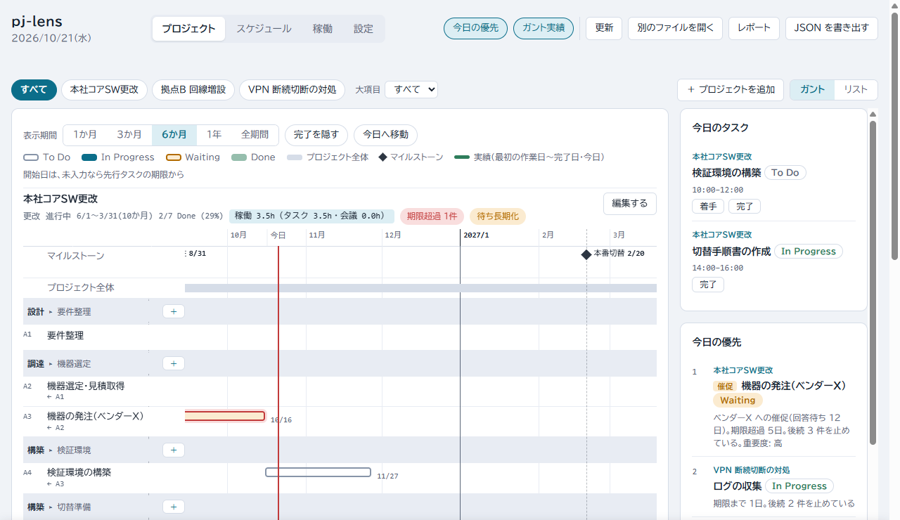
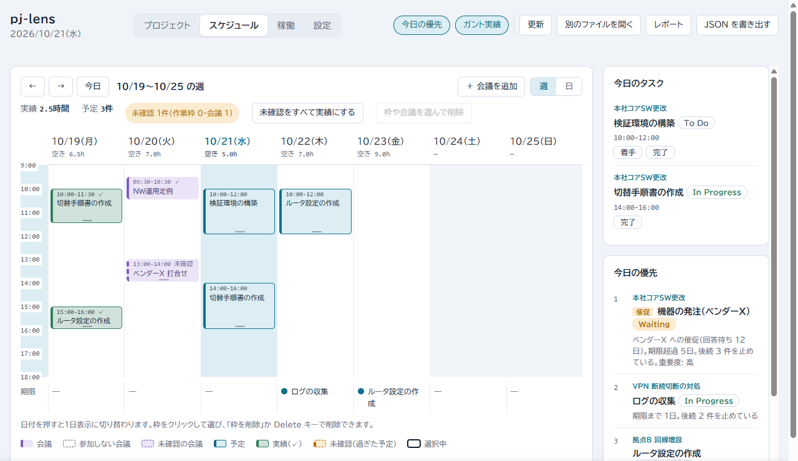
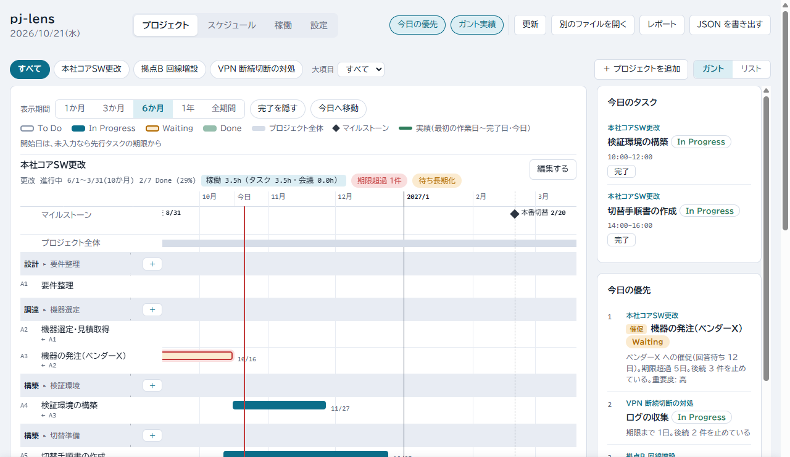

# pj-lens

ネットワーク設備の管理者が、複数のプロジェクトと自分のタスクを管理する Claude Code プラグインです。管理には、1 つの JSON ファイルと 1 枚のダッシュボードを使います。

## 機能

- **一覧**: 複数プロジェクトの進捗を、ガントとリストで見られます。遅延はバッジで知らせます。
- **今日の優先**: 期限・後続を止めている数・重要度から点数を付けます。理由と一緒に、タスクを点数順に並べます。
- **日程の見直し**: 期限を変えると、後続への影響を確認パネルで見られます。確認したら、まとめて反映できます。複雑な変更は `replan` に頼めます。
- **取り込み**: 貼った文章、Excel の WBS、予定表の会議を、`intake` が変更案にします。承認すると反映します。
- **レポート**: プロジェクトと期間を選ぶと、進捗を HTML で保存できます。保存した HTML は、そのまま共有できます。

## 前提条件

- Windows
- Claude Code
- Node.js（24 で動作確認）
- Microsoft Edge（または Chrome）
- Python 3.8 以上: Excel の WBS を取り込むときだけ使います。venv と ensurepip が使えるものにしてください。

1 人で使う前提です。複数人が同じ `data.json` を同時に編集する用途は、想定していません。共有にはレポートを使ってください。

## 導入方法

Claude Code で、次の 2 つを実行します。

```
/plugin marketplace add asama0101/pj-lens
/plugin install pj-lens@pj-lens
```

### 初回の準備

管理したいプロジェクトのフォルダで、Claude Code を開きます。次のコマンドで、セットアップします。

```
/pj-lens:init
```

次のように出ます。`.git` があるフォルダでは、`.gitignore` に `.pj-lens/` を追記します。

```
.pj-lens/data.json: 作りました
pj-lens.html: 作りました
.gitignore: 変更しませんでした（この場所も親のフォルダにも .git がないため、.gitignore は変更しません）

次の手順: ブラウザで pj-lens.html を開き、「ファイルを開く」で .pj-lens/data.json を選びます。
```

1. `pj-lens.html` を Edge で開き、「ファイルを開く」で `.pj-lens/data.json` を選びます。以後、画面での変更は、このファイルに直接保存されます。
2. 「＋ プロジェクトを追加」から登録します。名前・開始・期限・状態を直します。既定は、期限が今日の 30 日後、状態が「計画中」です。

- `/pj-lens:init` は、何度実行しても安全です。既存の `data.json` は変えません。`pj-lens.html` だけを、プラグインの更新に合わせて新しい版にします。同名の別ファイル `pj-lens.html` があるときは、何も作らずに止まります。
- 試すだけなら、`/pj-lens:init --sample` を使います。架空のサンプルデータが入ります。サンプルの日付は 2026 年 10 月前後です。URL に `?today=2026-10-20` を付けると、期限超過だらけになりません。
- 次回からは、`pj-lens.html` を開くだけで、前回のファイルが開きます。アクセス許可の確認が出たときは、開始画面の「前回のファイル（ファイル名）を開く」を押します。別のファイルにするときだけ、「別のファイルを開く」を使います。

### 作られるファイル

| パス | 内容 |
|---|---|
| `pj-lens.html` | ダッシュボード（プラグインに同梱の完成版のコピー） |
| `.pj-lens/data.json` | あなたのデータ |
| `.gitignore` の `.pj-lens/` の 1 行 | そのフォルダか親フォルダに `.git` があるときだけ追記します。UTF-8 以外の `.gitignore` は触らず、追記を案内します |

### アンインストールで消えるもの・残るもの

プラグインを削除すると、プラグイン専用のフォルダ（`~/.claude/plugins/data/` の下）の次の 2 つが消えます。

- Excel 用の Python 環境（venv）
- 予定表の MCP の指定 `pj-lens-mcp.json`

作業フォルダの `.pj-lens/data.json`・`pj-lens.html`・保存したレポートは残ります。不要なら、手で消してください。

再インストールしたときは、venv と MCP の指定を、もう一度作ります。venv は Excel の取り込み時の承認で、MCP の指定は `/pj-lens:mcp` で作ります。

## 使い方

### 毎朝の流れ

朝は、`pj-lens.html` を開いて、今日やることを決め、着手にします。ここでは Claude Code を使いません。

次の画像は、サンプルデータに「検証環境の構築」の作業枠（10:00〜12:00）を 1 つ足したものです。今日は 2026-10-21 にしています。

**1. 「今日の優先」を見る。** `pj-lens.html` を開くと、プロジェクト画面になります。右側の「今日の優先」に、上位 4 件が点数の高い順で並びます。点数は、期限・後続を止めている数・重要度から付けます。理由も一緒に出ます。「今日のタスク」は、今日に作業枠があるタスクです。



**2. 今日やるタスクを、時間枠に置く。** 上部の「スケジュール」を開きます。右側の「今日の優先」のタスクを、カレンダーの今日の列の時間枠へドラッグします（15 分刻み・長さ 1 時間）。今日の列に置いたタスクは、「今日のタスク」に出ます。



**3. 「着手」を押す。** 「今日のタスク」で、取りかかるタスクの「着手」を押します。状態が To Do（または Waiting）から In Progress に変わります。ガントのバーは濃くなります。変更は、その場で `.pj-lens/data.json` に保存されます。終わったら「完了」を押します。



### 日程が動いたとき

外部要因で日程が動いたときは、Claude Code に見直しを頼みます。`pj-lens.html` があるフォルダで、Claude Code を開きます。次のように頼みます。

```
/pj-lens:replan A3 が 5 日遅れた（原因: ベンダー）
```

「A3 が 5 日遅れた。影響を見て」のような、普通の言葉でも動きます。原因が読み取れないときは、「その他」として表に出ます。違うときは、承認の前に伝えてください。

サンプルデータでは、次の変更案の表が出ます。後続の A4 は、期限に余裕があるので動きません。

```
| タスク | 件名 | 旧期限 | 新期限 | 理由 |
|---|---|---|---|---|
| A3 | 機器の発注（ベンダーX） | 2026-10-16 | 2026-10-21 | 指定（+5日） |
```

- 後続が動くときは、その行も表に並びます。
- プロジェクト期限を超えるときは、警告と対処案が付きます。
- 前倒しのときは、後続も詰めるかを聞かれます。
- **承認するまで、タスクの期限は変わりません。** 依頼の記録だけが、`data.json` の受信箱に書かれます。
- 承認すると、期限が更新されます。原因と理由は、日程変更の履歴に残ります。書き込み後に検証が走り、結果が報告されます。
- 依頼は、画面の下端の帯「Claude Code に依頼する」の履歴にも出ます。承認は、画面からもできます。

Claude Code がデータを直したあと、画面は自動で読み直します。すぐに見たいときは、上部の「更新」を押します。

### 画面

ナビは、プロジェクト・スケジュール・稼働・設定の 4 つです。

- **プロジェクト**: プロジェクトで絞り込み、ガントとリストを切り替えます。
  - 右側の「今日のタスク」と「今日の優先」で、今日やることと次にやるタスクを確認します。「今日のタスク」は、今日に作業枠があるタスクです。
  - バーをドラッグすると、日付を変えられます。後続が動くときは、確認パネルで「後続も反映して履歴に残す」「このタスクだけ変える」「やめる」を選びます。
  - タスクは、大項目・中項目ごとにまとまります。各見出しの「＋」で、タスクを追加します。
  - 先行があるタスクの開始日は、先行の期限から決まります。
- **スケジュール**: 週／日の予定表です。
  - 「今日の優先」のタスクをドラッグして、作業枠を置きます。
  - 会議は、手入力するか、予定表から取り込みます。
  - 過ぎた枠・会議は、「実績にする」で確定します。
  - 「今日のタスク」の「着手」「完了」で、タスクの状態も変えられます。
- **稼働**: 週／月ごとに、プロジェクト別のタスクと会議の時間を集計します。確認済みのものだけを数えます。
- **設定**: 勤務時間・待ち長期化の日数・見出しの呼び名、日本の祝日（表示のみ）、休み、営業日として扱う日、会議名のキーワード規則を扱います。WBS の取り込み記録も出ます。

### Claude Code に頼む

| コマンド | 使いどころ |
|---|---|
| `/pj-lens:init` | セットアップ |
| `/pj-lens:replan` | 外部要因で日程が動いたときの、影響範囲の計算と変更案 |
| `/pj-lens:intake` | 文章・Excel の WBS・予定表の会議の取り込み、会議のプロジェクト規則 |
| `/pj-lens:mcp` | 予定表で使う MCP の指定 |
| `/pj-lens:watch` | 画面の「Claude Code に依頼する」から届く依頼を、見張って処理する |
| `/pj-lens:inbox` | 届いている依頼を、今ある分だけ処理する（「R3 を承認」「R3 を却下」も） |
| `/pj-lens:holidays` | 日本の祝日（内閣府の祝日一覧）を取得して保存する。営業日の計算で、土日に加えて飛ばす日になる |

`replan` と `intake` は、変更案を示します。**承認を得てから**、データを書き換えます。

計算コマンドの実行時に、Claude Code が許可を確認することがあります。このプラグインのコマンドなので、許可して構いません。

#### 画面から頼む

画面の下端の帯「Claude Code に依頼する」から、次の 3 つを文章で頼めます。

- 期限の見直し
- 先行の対応付け
- タスクの登録

1. Claude Code で `/pj-lens:watch` を 1 回実行します。見張っている間、帯に「Claude Code が見ています」と出ます。
2. 帯を開いて、対象のプロジェクトを選びます。依頼を書いて、「依頼を送る」を押します。例: 「A3 が 45 日遅れた（原因: ベンダー）。A3 の後に A5 を結んで」
3. 数秒で、帯の履歴に提案の表が出ます。確認して、「承認して反映する」を押します。修正は「修正を依頼する」に返信します。却下もできます。

履歴は最新の 20 件で、完了したものから消えます。反映した内容は、`data.json` の `changeLog` に残ります。

期限の移動と、営業日で期限を決める登録（「A4 の 3 営業日後に作業を登録」など）は、同じ依頼にできません。先に期限の移動を頼んで、承認してください。そのあとで、登録を頼みます。一緒に頼むと、期限の移動だけを提案します。

期限を日付で指定する登録（「A5 を 12/25 期限で登録」など）は、一緒に頼めます。

#### 取り込み

どれも「読み取り → 変更案の表 → あなたの承認 → 書き込み」の順です。承認の前は、タスクなどのデータを変えません。

| 依頼 | 内容 |
|---|---|
| `/pj-lens:intake` ＋本文 | 貼ったメール・議事録・メモから、タスクの登録案を作ります。期限が書かれていなければ、先行と営業日（土日・日本の祝日・登録した休みを除く日）で、日程を仮に置きます。行番号つきの表で見せるので、「3 行目を 10 営業日に」のように直してから承認します。日程変更は `replan` を案内します |
| `/pj-lens:intake wbs <ファイル> [プロジェクト]` | Excel（または CSV）の WBS をタスクとして取り込みます |
| `/pj-lens:intake calendar [期間]` | 予定表の会議を取り込みます |
| `/pj-lens:intake rules` | 会議のプロジェクト規則（件名のキーワード → プロジェクト）を見る・変える |

- WBS の列の意味は、Claude が判断します。対応表を見せて、確認を取ります。承認された対応表は、プロジェクトごとに保存されます。次回は、確認するだけです。再取り込みでは、同じ項目を更新します。画面で直した件名は、上書きしません。
- Excel の取り込みでは、初回だけ専用の Python 環境（venv）を作ります。作る前に、場所と内容を示して承認を求めます。承認しない、または Python が無いときは、Excel を CSV に保存してください。Python なしで取り込めます。
- 予定表は、先に `/pj-lens:mcp` で、使う MCP（Outlook など）を指定します。MCP はこのプラグインに同梱していません。先に Claude Code に用意してください。

### レポート

画面上部の「レポート」ボタンを押します。プロジェクト（複数選択）と期間を選び、「HTML で保存」を押します。

期間は、今週・先週・先週と今週・今週と来週・来週・今月・先月・自由指定から選びます。週末に「今週の実績＋来週の予定」を 1 枚で出すときは、「今週と来週」を選びます。

- Edge・Chrome では、保存ダイアログが開きます。保存先と名前を選べます。対応しないブラウザでは、ダウンロードフォルダに保存されます。名前は `pj-lens_report_A+B_2026-W42_20261021.html` のようになります。
- 内容は、全体一覧・プロジェクト別の詳細・期間の実績・今後の予定です。会議は時間枠だけを載せます。件名は、パネルの「会議の件名を載せる」を選んだときだけ載せます。
- PDF が要るときは、保存した HTML をブラウザで開きます。印刷画面から「PDF として保存」を選びます。

## 設定

設定は「設定」タブで変えられます。変更は、その場でファイルに保存されます。`.pj-lens/data.json` の `settings` に、直接書くこともできます。省略した項目は、既定値になります。形が違う値は、「設定」タブの項目の横に注意が出ます。

| 項目 | 内容 | 既定 |
|---|---|---|
| `workday` | 勤務時間（`start`・`end`、`HH:MM` 形式） | 09:00〜18:00 |
| `waitingLongDays` | `Waiting` を「待ち長期化」とみなす日数 | 7 |
| `labels` | 見出しの呼び名（`group`・`subgroup`） | 大項目・中項目 |
| `projectRules` | 会議のプロジェクト規則（`keyword`・`projectId`） | なし |
| `holidays` | 手動の休み（`date`・`kind`＝祝日／有給／その他・`note`） | なし |
| `workdays` | 営業日として扱う日（`date`・`note`）。休日出勤など | なし |
| `reportShowMeetingTitles` | レポートで「会議の件名を載せる」の最初の状態（ファイルに直接書きます） | `false` |
| `nationalHolidays` | 取得した日本の祝日。`/pj-lens:holidays` が書きます。営業日で期限を置く依頼のとき、未取得・古い・範囲外なら自動で取得します | なし |

営業日の計算とスケジュールの作業枠は、土日・日本の祝日・手動の休みを飛ばします。「営業日として扱う日」に指定した日は、これらでも営業日として数えます。作業枠も置けます。

直接書くときの例です。

```json
"settings": {
  "workday": { "start": "08:30", "end": "17:30" },
  "waitingLongDays": 5,
  "labels": { "group": "フェーズ", "subgroup": "作業" },
  "projectRules": [{ "keyword": "ベンダーX", "projectId": "A" }]
}
```

画面右上の「今日の優先」「ガント実績」のスイッチは、このブラウザに保存されます。

## 困ったとき

| 症状 | 対処 |
|---|---|
| 保存時に「他で更新されました。再読込してください」と出る | 他の手段で `data.json` が更新され、画面の変更を当て直せませんでした。ふだんは自動で当て直して保存します。上書きはしません。上部の「更新」で読み直します。**読み直すと、画面の保存できていない変更は消えます。** 残したいときは、先にバナーの「変更を JSON で書き出す」で退避します |
| 毎回ファイルを選ぶ必要がある。「前回のファイルの記憶を読めませんでした」と出る | このブラウザが記憶を許していません。シークレットウィンドウや、サイトデータを終了時に消す設定などが原因です。通常のウィンドウで開きます |
| 変更が保存されず、「JSON を書き出す」しか出ない | 直接保存に対応しないブラウザです。Edge で開きます。書き出した JSON で保存することもできます |
| `/pj-lens:init` が「何も変更せずに止めました」と出る | 同名の別ファイル `pj-lens.html` があります。名前を変えるか移動してから、もう一度実行します |
| 帯が「見ていません」になっている | `/pj-lens:watch` を実行します。見張りは 30 分ごとに終わるので、そのたびに再起動します。急ぎの依頼は、`/pj-lens:inbox` で処理できます |
| 読み込み時に「注意: settings.…」と出る | `settings` の値の形が違います（例: 勤務時間が `9:00`）。「設定」タブで直せる項目は、そこで直します。それ以外は、`.pj-lens/data.json` を上の例の書式に合わせて直します。勤務時間が `HH:MM` でないと、スケジュール画面が動きません |
| Excel の取り込みで専用環境が使えない | 承認のうえで venv を作ります。作れないときは、Excel を CSV に保存して取り込みます |

## 開発者向け

テスト・ビルド・構成・データ形式・設計判断・変更履歴は、[docs/development.md](docs/development.md) を参照してください。

## ライセンス・連絡先

MIT（[LICENSE](LICENSE)）。不具合や要望は、[GitHub の Issues](https://github.com/asama0101/pj-lens/issues) へどうぞ。
